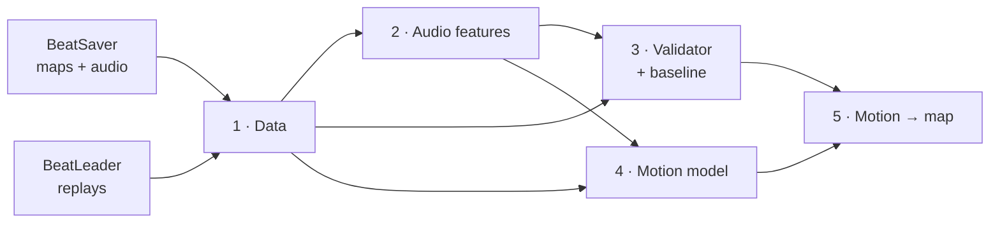

# kata

**Music-to-Beat Saber map generation via learned player motion.**

Most map generators predict notes straight from the audio. kata goes the
other way: it first learns *how real players move* to a song (head and both
sabers, from thousands of BeatLeader replays), then derives the notes from
that motion. A map that comes from a plausible swing should be playable by
construction, and the motion carries the flow that good maps have.

> **Status:** research project, in progress. Phases 1–3 are done; Phase 4
> (the motion model) is training its pilot run. There is no map generator
> you can download yet; there is a reproducible pipeline you can run.

---

## How it works



| Phase | What it does | Status |
|---|---|---|
| **1 · Data** | Crawls the BeatSaver catalogue, keeps ranked (Tier A) and well-rated curated (Tier B) maps, and parses v2/v3/v4 map formats into one schema timed in beats *and* seconds. Downloads a small, player-diverse sample of BeatLeader replays (3 per difficulty) and parses them into head/hand tracks. Parquet is the source of truth, with DuckDB on top. | ✅ ~5.4k maps, 15k difficulties, 13.5M notes |
| **2 · Audio** | Turns every song into features on one 100 fps grid that lines up with map and replay time: log-mel, onsets, loudness, chroma, Demucs stems (drums, bass, other, vocals), beats/downbeats ([Beat This!](https://github.com/CPJKU/beat_this)) and repetition structure (A/B/A/C…). | ✅ 5,347 songs |
| **3 · Validator + baseline** | A playability scorer: notes are grouped into per-hand swings with a forehand/backhand parity solved by dynamic programming, then checked for parity breaks, vision blocks, resets, swing angles and speed. Outputs a pass/fail gate, a 0–100 score and per-swing issues. Plus a rule-based baseline mapper (onsets + parity-correct patterns) that exports maps the game and ArcViewer can load. It's the bar later models must beat. | ✅ AUC 0.88 ranked vs. low-rated; baseline 100 % pass |
| **4 · Motion model** | A ~46M-parameter diffusion transformer (EDGE-style) that generates head + saber motion and a per-hand hit channel at 50 fps, cross-attending to the audio features and conditioned on difficulty and notes-per-second. Whole songs are generated as overlapping 12.8 s windows. Evaluated against real held-out replays and the Phase 3 baseline, plus a local 3D viewer that shows generated vs. real side by side. | 🚧 pilot training |
| **5 · Motion → map** | Swing peaks → note time, lane, layer, cut direction and colour; validator in the loop; VR playtests. | planned |
| **6–7** | Structure-aware planning, style control, section inpainting; then editor integration. | planned |

Each phase has a design doc in [`docs/phases/`](docs/phases/) that was
reviewed before any code was written, with every decision, measurement and
pilot finding recorded. The roadmap is in [`docs/PLAN.md`](docs/PLAN.md).

---

## Running it yourself

### What you need

- **Windows or Linux** (macOS isn't supported, because of a Demucs dependency pin).
- **Python 3.13** and [**uv**](https://docs.astral.sh/uv/).
- **An NVIDIA GPU** for Phases 2 and 4. The PyTorch wheels are CUDA 13
  builds; development used an RTX 5080 16 GB. Phases 1 and 3 run on CPU.
- **Disk:** ~200 GB for the full dataset (maps ~52 GB, audio features ~81 GB,
  Tier A replays ~64 GB). The pilot subset needs a few GB.

### Install

```bash
git clone https://github.com/ISenseHostility/kata.git
cd kata
uv sync                   # data pipeline + validator
uv sync --extra audio     # + PyTorch, Demucs, Beat This! (Phases 2 and 4)
uv run pytest             # optional: the test suite runs on synthetic data
```

All data goes under one directory, `E:\kata-data` by default. Point it
somewhere else with the `KATA_DATA` environment variable:

```bash
export KATA_DATA=/path/to/kata-data        # PowerShell: $env:KATA_DATA = "D:\kata-data"
```

Everything runs through one CLI, `uv run kata <phase> <stage>`, and every
`--help` lists the options. The long-running stages (downloads,
audio features, training, sampling) are **resumable**: if one is
interrupted, run the same command again and it continues where it stopped.

### Try it small first: the pilot

Every phase has a pilot that runs all of its stages on a fixed subset of
about 200 maps. It's the quickest way to see the whole thing work:

```bash
uv run kata data crawl-catalog      # the full BeatSaver metadata catalogue (needed once)
uv run kata data pilot              # maps, replays, parsing, report
uv run kata audio pilot             # features for the pilot songs (GPU)
uv run kata validate pilot          # validator + baseline maps on the pilot
uv run kata motion prepare --pilot  # replays → 50 fps motion tracks
uv run kata motion train pilot-1 --pilot --hours 2
```

Reports land in `$KATA_DATA/reports/` as Markdown.

### The full pipeline

<details>
<summary><b>Phase 1: data</b></summary>

```bash
uv run kata data crawl-catalog
uv run kata data select                  # quality tiers
uv run kata data download-maps
uv run kata data parse-maps
uv run kata data build                   # song groups, train/val/test splits, DuckDB views
uv run kata data report

# replays (needed for Phase 4)
uv run kata data crawl-leaderboards --tier A
uv run kata data select-replays --k 3
uv run kata data download-replays
uv run kata data parse-replays
uv run kata data build
```
</details>

<details>
<summary><b>Phase 2: audio features</b> (GPU)</summary>

```bash
uv run kata audio features      # stems, spectral features, beats (the long one)
uv run kata audio structure
uv run kata audio sync          # map ↔ audio alignment checks
uv run kata audio stats         # train-split normalisation statistics
uv run kata audio report
```
</details>

<details>
<summary><b>Phase 3: validator and baseline</b></summary>

```bash
# optional: low-rated maps (Tier D) to calibrate the score against; run before `analyse`
uv run kata data select-lowrated
uv run kata data download-lowrated
uv run kata data parse-lowrated

uv run kata validate analyse    # swings and issues for every difficulty
uv run kata validate reference  # reference quantiles from ranked train maps
uv run kata validate score      # scores and the pass/fail gate
uv run kata validate corrupt    # does each rule catch issues injected into clean maps?
uv run kata validate report
uv run kata baseline generate   # baseline maps (folders + zips) for val/test songs
```

The baseline maps are written to `$KATA_DATA/generated/baseline/` as zips
you can open in [ArcViewer](https://allpoland.github.io/ArcViewer/) or drop
into the game.
</details>

<details>
<summary><b>Phase 4: motion model</b> (GPU)</summary>

```bash
uv run kata motion prepare
uv run kata motion train base --hours 4            # first session
uv run kata motion train base --resume --hours 4   # continue later, as often as needed
uv run kata motion tune base                       # pick the guidance weight on val
uv run kata motion sample base --split val         # whole songs for every val difficulty
uv run kata motion evaluate base --split val
uv run kata motion viewer base --split val         # 3D generated-vs-real pages
uv run kata motion report --run base
```

Training is split into **sessions of any length**. `--hours N` stops cleanly
and saves; `--resume` continues *exactly* where it stopped (bit-identical to
an uninterrupted run, which is tested). Ctrl+C also ends a session cleanly
after the current step. A full run is ~80k steps, about 12 GPU-hours on an
RTX 5080.
</details>

---

## Data and usage

kata downloads from the public [BeatSaver](https://beatsaver.com) and
[BeatLeader](https://beatleader.xyz) APIs as a polite client: rate-limited,
cached so nothing is fetched twice, with a User-Agent that points back
here. Out of respect for the mappers and players whose work this is built
on:

- **No data is redistributed.** Audio, map files, replays and API dumps stay
  on your machine. This repo contains code and docs only.
- **Non-commercial.** BeatSaver's terms forbid commercialising site content.
- **Generated maps** uploaded to BeatSaver must be declared as AI-generated.
- Only pseudonymous player ids needed for joins are stored; no player names
  appear in processed tables.

kata is an independent project, not affiliated with Beat Games, BeatSaver
or BeatLeader.

## License

The code and docs are licensed under the [GNU General Public License v3.0
or later](LICENSE). The license covers this repository only, not the maps,
audio and replays the pipeline downloads; those stay under their owners'
terms (see above).

## Repository layout

```
src/kata/
  data/       Phase 1: BeatSaver/BeatLeader clients, map formats, BSOR parser
  audio/      Phase 2: features, stems, beats, structure, alignment
  validate/   Phase 3: swing model, rules, scoring, calibration
  baseline/   Phase 3: rule-based mapper and map export
  motion/     Phase 4: motion tracks, diffusion model, training, sampling, viewer
  cli.py      the `kata` command
docs/
  PLAN.md     roadmap
  phases/     design doc + implementation plan per phase
tests/        pytest suite on synthetic data, no downloads or GPU needed
```
